<picture>
  <source media="(prefers-color-scheme: dark)" srcset="assets/skyline-dark.svg">
  
</picture>

  <a href="https://rohit-balaji-portfolio.vercel.app">Portfolio</a> ·
  <a href="https://www.linkedin.com/in/rohit-balaji-a8a358373/">LinkedIn</a> ·
  <a href="mailto:rohitvb26@gmail.com">rohitvb26@gmail.com</a>

I build full-stack, AI-powered apps for real problems, so far in studying, hiring, banking and developer tools. I care about software that works well for the people using it, and I'm always exploring what's next, from local and agentic AI workflows to a sharper approach to a familiar problem. I'm a Software Engineering student at the University of Auckland, graduating in 2027.

**Hackathons:** One of five winners, ZEIL AI Hackathon 2026 · Winner of Challenge 3, Innovate AI Hackathon 2026 (BNZ × AWS) · 1st Place and the Emerging Talent award, GDGCxDEVS Hackathon 2025

### Lately

**Now:** AI Intern at ZEIL (Nov 2026 – Feb 2027)  
**Exploring:** "AI proposes, code proves", where a model does the open-ended work and code verifies the result.

- **Witness:** on a benchmark app with 23 seeded bugs, 14–21% of the AI's raw claims were false, and replaying every finding in a fresh browser caught all of them. Clean runs raised zero false alarms.
- **Closure:** a writer model drafts rejection feedback, code checks every CV quote it uses, and a critic model passes 27/27 hand-labelled cases.

### Projects

**[Friction](https://usefriction.vercel.app)**: AI study tool from your notes  
2026 · Lead developer · [Live app](https://usefriction.vercel.app) · [Demo video](https://www.youtube.com/watch?v=xb8-jHmX2ho)  
Turns a PDF, a photo or pasted notes into a complete interactive lesson that teaches your own material from the fundamentals up. One schema-constrained call generates the slides, fill-in-the-blank checks, quiz and flashcards, and slides can run simulations seeded with the numbers in your notes. It also files notes by subject and topic, has a tutor chat that sees your current slide and searches your notes, and schedules reviews with spaced repetition. Evolved from Dazey.

**[Witness](https://github.com/RohitB2005/witness)**: AI pre-release tester for web apps  
2026 · Solo · [Demo video](https://www.youtube.com/watch?v=WtN6w7USRxQ) · [Code](https://github.com/RohitB2005/witness)  
Give it a running web app's URL and an AI agent drives a real browser through the core user journeys, then reports a release verdict, security issues and bugs with evidence, plus a Playwright test for each confirmed bug. Code, not the AI, decides how confident to be in each finding, sorting it into confirmed, likely, needs review or discarded.

**[Closure](https://closure-mu.vercel.app)**: AI feedback for rejected applicants  
2026 · Solo · [Live app](https://closure-mu.vercel.app) · [Demo video](https://www.youtube.com/watch?v=C7jo7JYMlrM) · [Code](https://github.com/RohitB2005/closure)  
**One of five winners at ZEIL's AI Hackathon 2026**, built solo in a day; it earned me a paid AI internship at ZEIL. Closure drafts honest feedback and a next step for every applicant a recruiter rejects. A writer model drafts, code verifies every CV quote, and a critic model checks the message and the recruiter's note against the NZ Human Rights Act, holding discriminatory reasons instead of rewording them.

**RippleGuard**: credit-risk stress simulator  
2026 · Team of 3 · [Demo video](https://youtu.be/IeoIhRrnaW8)  
**Winner of Challenge 3** at the Innovate AI Hackathon 2026, run with BNZ and AWS. It models a bank's lending book as a graph, so a sector shock reaches suppliers and guarantors it never hit directly, before anyone misses a payment. Scoring is deterministic, with no LLM in the loop, and every flag cites its policy clause; Amazon Comprehend checks that override justifications are substantive. Built on synthetic data; I owned the AWS backend, deploy tooling and two frontend screens.

**[Dazey](https://github.com/hazikchaudhry/Dazey-First-Place-Winner)**: AI journal & note taker  
2025 · Team of 6 · [Demo video](https://youtu.be/RAKYhmgpSGU) · [Code](https://github.com/hazikchaudhry/Dazey-First-Place-Winner)  
**1st Place and the Emerging Talent award** at the GDGCxDEVS Hackathon 2025, judged by engineers from Visa, Pushpay, Atlassian and Serato. A privacy-first Electron journal on local AI (Gemma through Ollama) that sorts raw notes into categories, spots habit patterns and answers questions about past notes with a RAG chatbot. I built every frontend screen and the habit tracker, and helped build the Flask AI backend.

**[gitme-ai](https://pypi.org/project/gitme-ai/)**: AI git commit generator  
2026 · Solo · [PyPI](https://pypi.org/project/gitme-ai/) · [Code](https://github.com/RohitB2005/gitme-ai)  
A command-line tool on PyPI that reads your staged diff and writes a Conventional Commits message for it. It's local-first: by default it runs Gemma on your own machine through Ollama, so your diffs never leave it, and OpenAI or OpenRouter are one setting away. Add context the diff can't show, or copy the message straight to your clipboard.

**Also built**
- [TrialAI](https://github.com/RohitB2005/TrialAI-Game): a JavaFX courtroom game about AI accountability. Question three LLM-powered witnesses, then rule on whether the AI is guilty. 2025 · Team of 3.
- [Code Adventure](https://code-adventure-rohit.vercel.app/index.html): a pixel-art game that teaches CSS, where the code you write moves the adventurer. Solo.

### Stack

**Languages:** TypeScript · Python · Java · JavaScript · HTML/CSS · C  
**AI:** Claude · Gemini · OpenAI · Ollama · OpenRouter · Vercel AI SDK · LangChain · Zod · RAG · agents · evals  
**Apps and cloud:** React · Next.js · Node.js · Express · Flask · Tailwind · Electron · JavaFX · AWS (Lambda, API Gateway, DynamoDB, S3, Comprehend) · Firebase · Vercel  
**Testing:** Playwright · pytest · Vitest · JUnit

### Outside code

*One Piece* · the *Red Rising* books · films, shows and a lot of games · swimming · deep dives into niche problems · peaked Emerald in League of Legends

---

The skyline is my last 12 months on GitHub: one building per week, one lit window per contribution. A GitHub Action redraws it every night.
